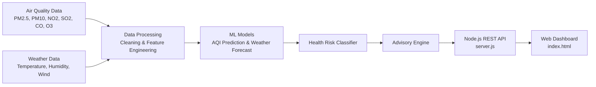

<div align="center">

# AI-Powered Health and Environment Advisory System

**Turning environmental data into personalized, actionable health recommendations.**


[Overview](#-overview) •
[Features](#-key-features) •
[Architecture](#-system-architecture) •
[Screenshots](#-screenshots) •
[Getting Started](#-getting-started) •
[Roadmap](#-roadmap)

</div>

<p align="center">
  <!-- Add your best dashboard screenshot here as the hero image -->
  
</p>

---

## 📌 Overview

Air pollution and changing weather directly affect public health, yet raw AQI numbers and forecasts rarely tell people what to *do*. **Vayu** closes that gap.

Vayu is an AI-powered health advisory system that combines **air quality monitoring**, **weather forecasting**, and **machine learning** to assess pollution-related health risks and generate clear, personalized preventive-care recommendations.

### The Problem
- AQI values are hard for the general public to interpret.
- Weather and air quality are usually reported separately, not as a combined health risk.
- Vulnerable groups (children, elderly, people with respiratory conditions) need tailored guidance.

### The Solution
Vayu ingests environmental data, predicts conditions using ML models, classifies health risk levels, and converts them into plain-language advisories through an interactive dashboard.

> **Objective:** Bridge the gap between environmental intelligence and preventive healthcare by transforming environmental data into meaningful, actionable health recommendations.

---

## ✨ Key Features

| | Feature | Description |
|---|---|---|
| 🏭 | **Air Quality Monitoring** | Analyzes AQI levels and identifies pollution-related health risks |
| 🌦️ | **Weather Prediction** | ML models forecast weather conditions from environmental parameters |
| 🩺 | **Personalized Health Advisory** | Recommendations based on air quality, weather, and associated risks |
| 📊 | **Data Analysis & Visualization** | Interactive dashboards showing environmental trends and insights |
| 🤖 | **AI-Based Recommendations** | Intelligent suggestions supporting preventive healthcare and awareness |

---

## 🏗️ System Architecture



### How It Works

1. **Data Collection:** Pollution and weather data are gathered and stored (see `PollutionDataProcessing (1).ipynb`).
2. **Preprocessing:** Missing values are handled, features are engineered, and data is prepared for modeling.
3. **Model Training:** Scikit-learn models are trained to predict AQI and forecast weather conditions (see `MAIN_FILE_VAYU_BACKEND_clean.ipynb`).
4. **Risk Classification:** Predicted AQI is mapped to a health risk category.
5. **Advisory Generation:** Risk level and weather are combined into personalized recommendations.
6. **Delivery:** The backend serves results via REST APIs to the dashboard.

### AQI Categories Used

| AQI Range | Category | General Guidance |
|---|---|---|
| 0 – 50 | 🟢 Good | Minimal impact; normal outdoor activity |
| 51 – 100 | 🟡 Satisfactory | Sensitive individuals may feel minor discomfort |
| 101 – 200 | 🟠 Moderate | Breathing discomfort for people with lung or heart disease |
| 201 – 300 | 🔴 Poor | Discomfort on prolonged exposure; limit outdoor activity |
| 301 – 400 | 🟣 Very Poor | Respiratory illness on prolonged exposure; avoid outdoor exertion |
| 401 – 500 | ⚫ Severe | Affects healthy people; serious risk for those with existing conditions |

> Adjust this table to match the scale your model actually uses.

---

## 🖼️ Screenshots

### Model Performance Reports

<p align="center">
  
  
</p>
<p align="center">
  <em>Left: AQI model evaluation report &nbsp;|&nbsp; Right: Weather forecast and health advisory report</em>
</p>

### Application Interface

<p align="center">
  
  
</p>
<p align="center">
  
  
</p>

<!--
  Suggested extra visuals to add (replace the paths with your own images):
  1. Confusion matrix / feature importance plot from your AQI model
  2. Predicted vs actual AQI line chart
  3. A short demo GIF of the dashboard (record with ScreenToGif or LICEcap)
  4. Mobile / responsive view screenshot
-->

---

## 🧰 Tech Stack

| Layer | Technologies |
|---|---|
| **Machine Learning** | Python, Scikit-learn |
| **Data Analysis** | Pandas, NumPy |
| **Visualization** | Matplotlib, Seaborn |
| **Backend** | Node.js, REST APIs |
| **Frontend** | HTML, JavaScript (React.js) |
| **Database** | MySQL |
| **Tooling** | Jupyter Notebook, Git, GitHub |

---

## 📁 Project Structure

```
vayu/
├── MAIN_FILE_VAYU_BACKEND_clean.ipynb   # Core ML pipeline: model training, prediction, advisory logic
├── PollutionDataProcessing (1).ipynb    # Data cleaning, preprocessing, and exploration
├── server.js                            # Node.js server exposing the REST API
├── index.html                           # Frontend dashboard
├── package.json                         # Node.js dependencies and scripts
├── package-lock.json                    # Locked dependency versions
├── _env.example                         # Template for environment variables
├── HOW TO RUN.txt                       # Quick-start notes
└── README.md                            # Project documentation
```

---

## 🚀 Getting Started

### Prerequisites

- [Python 3.x](https://www.python.org/downloads/) with Jupyter Notebook
- [Node.js](https://nodejs.org/) (v16 or later) and npm
- MySQL (if the database features are enabled)
- API keys for your air quality and weather data providers

### Installation

**1. Clone the repository**

```bash
git clone https://github.com/<your-username>/<repo-name>.git
cd <repo-name>
```

**2. Install Python dependencies**

```bash
pip install pandas numpy scikit-learn matplotlib seaborn jupyter
```

**3. Install Node.js dependencies**

```bash
npm install
```

**4. Configure environment variables**

```bash
cp _env.example .env
```

Then open `.env` and add your own values:

| Variable | Description |
|---|---|
| `<AQI_API_KEY>` | API key for the air quality data provider |
| `<WEATHER_API_KEY>` | API key for the weather data provider |
| `<DB_HOST>`, `<DB_USER>`, `<DB_PASSWORD>`, `<DB_NAME>` | MySQL connection details |
| `PORT` | Port for the server (default `<3000>`) |

> ⚠️ **Never commit your `.env` file.** It is listed in `.gitignore`; use `_env.example` as the shared template.

**5. Run the notebooks**

Run these in order using Jupyter:

1. `PollutionDataProcessing (1).ipynb` for data preparation
2. `MAIN_FILE_VAYU_BACKEND_clean.ipynb` for model training and backend logic

**6. Start the server**

```bash
node server.js
```

**7. Open the app**

Visit `http://localhost:<PORT>` in your browser.

---

## 🔌 API Reference

> Replace with your actual routes from `server.js`.

| Method | Endpoint | Description |
|---|---|---|
| `GET` | `/api/aqi?city=<city>` | Returns current and predicted AQI for a city |
| `GET` | `/api/weather?city=<city>` | Returns the weather forecast for a city |
| `GET` | `/api/advisory?city=<city>` | Returns the personalized health advisory |

**Example response**

```json
{
  "city": "Gurugram",
  "aqi": 312,
  "category": "Very Poor",
  "advisory": [
    "Avoid outdoor exercise",
    "Wear an N95 mask if you must go out",
    "Keep windows closed and use an air purifier"
  ]
}
```

---

## 📈 Model Details

| Item | Details |
|---|---|
| **Task 1** | AQI prediction (`<regression / classification>`) |
| **Task 2** | Weather condition forecasting |
| **Algorithms** | `<e.g. Random Forest, Gradient Boosting, Linear Regression>` |
| **Input Features** | `<PM2.5, PM10, NO2, SO2, CO, O3, temperature, humidity, wind speed>` |
| **Evaluation Metrics** | `<R², RMSE, MAE / Accuracy, F1-score>` |
| **Best Result** | `<add your best score here>` |

---

## 🗺️ Roadmap

- [x] Air quality analysis and AQI prediction
- [x] Weather forecasting model
- [x] Health advisory generation
- [x] Interactive dashboard
- [ ] User profiles (age, existing conditions) for deeper personalization
- [ ] Real-time alerts for hazardous AQI levels
- [ ] Multi-city support
- [ ] Mobile-friendly progressive web app
- [ ] Cloud deployment

---

## 🤝 Contributing

Contributions are welcome.

1. Fork the repository
2. Create a feature branch: `git checkout -b feature/your-feature`
3. Commit your changes: `git commit -m "Add your feature"`
4. Push to the branch: `git push origin feature/your-feature`
5. Open a Pull Request

---

## 👥 Contributors

| Name | GitHub |
|---|---|
| Vansh Khanna | [@vansh-0606-khanna](https://github.com/vansh-0606-khanna) |


---

## 📄 License

Distributed under the MIT License. See [`LICENSE`](LICENSE) for details.

---

## ⚠️ Disclaimer

Project provides general informational guidance based on environmental data and machine learning predictions. It is **not** a substitute for professional medical advice, diagnosis, or treatment. Always consult a qualified healthcare provider for medical concerns.

<div align="center">

**If you found this project useful, consider giving it a ⭐**

</div>
